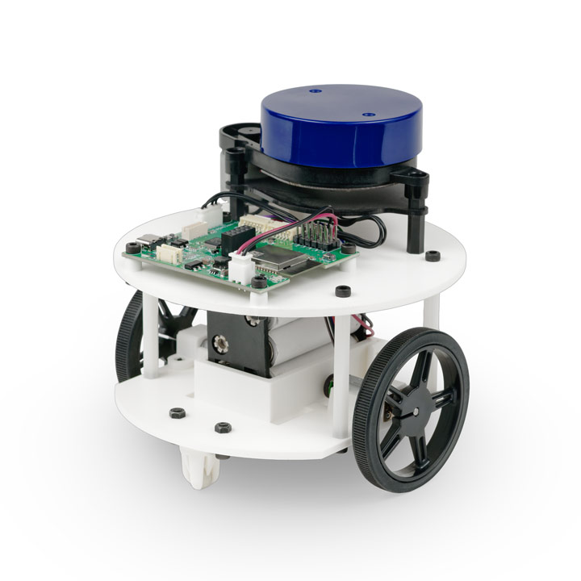

# ライトローバーE32 ROS2パッケージ

<p align="center">
  
</p>

ヴイストン株式会社より発売されている小型移動台車「[ライトローバーE32](https://www.vstone.co.jp/products/lightroverE32/index.html)」をROS 2で制御するためのパッケージです。別途Linux搭載PC及びロボット実機が必要になります。

# 目次
<!-- TOC -->

- [概要](#%E6%A6%82%E8%A6%81)
- [必要機器 & 開発環墁](#%E5%BF%85%E8%A6%81%E6%A9%9F%E5%99%A8--%E9%96%8B%E7%99%BA%E7%92%B0%E5%A2%83)
- [ファイルの構成](#%E3%83%95%E3%82%A1%E3%82%A4%E3%83%AB%E3%81%AE%E6%A7%8B%E6%88%90)
- [パッケージ構成](#%E3%83%91%E3%83%83%E3%82%B1%E3%83%BC%E3%82%B8%E6%A7%8B%E6%88%90)
- [インストール方法](#%E3%82%A4%E3%83%B3%E3%82%B9%E3%83%88%E3%83%BC%E3%83%AB%E6%96%B9%E6%B3%95)
- [ライセンス](#%E3%83%A9%E3%82%A4%E3%82%BB%E3%83%B3%E3%82%B9)
- [貢献](#%E8%B2%A2%E7%8C%AE)

<!-- /TOC -->

## 概要

このパッケージは、ライトローバーE32台車ロボット用のROS 2パッケージを提供します。 
このパッケージには、ロボットの制御、センサーの読み取り、およびロボットアプリケーションの開発に必要なノードが含まれています。

## 必要機器 & 開発環墁
-  ライトローバーE32:
  - 製品ページ: [https://www.vstone.co.jp/products/lightroverE32/index.html](https://www.vstone.co.jp/products/lightroverE32/index.html)
  - 販売ページ: [https://www.vstone.co.jp/robotshop/index.php?main_page=product_info&cPath=928_953&products_id=5440](https://www.vstone.co.jp/robotshop/index.php?main_page=product_info&cPath=928_953&products_id=5440)
- Ubuntu Linux - Noble Numbat (24.04)
- ROS 2 Jazzy Jalisco

## ファイルの構成
   ```
    ros2_ws/src
    ━lightrover_e32_ros2
    │　━lightrover_e32
    │　━lightrover_e32_bringup
    │　━lightrover_e32_navigation
    │　━lightrover_e32_description
   ```

## パッケージ構成
- `lightrover_e32`: ライトローバーE32のメタパッケージ。
- `lightrover_e32_bringup`: ライトローバーE32の起動に関連するノードやlaunchファイルを提供します。
- `lightrover_e32_navigation`: ライトローバーE32のSLAMやNavigationに関連するノードやlaunchファイルを含んでいるパッケージです。
- `lightrover_e32_description`: ライトローバーE32の物理モデルやURDFモデルを含んでいるパッケージです。

## インストール方法
このパッケージのインストール方法を含めた、ライトローバーE32のセットアップ・使用方法については、[ライトローバーE32WEBドキュメント](https://vstoneofficial.github.io/lightrover_e32_webdoc/)をご参照ください。

## Jazzy での動作確認

Ubuntu 側で変更を反映してから、ワークスペースを再ビルドしてください。

```bash
source /opt/ros/jazzy/setup.bash
cd ~/ros2_ws
colcon build --symlink-install
source install/setup.bash
```

マウス操作では `wrc940_bringup.launch.py` と、別ターミナルで
`mouse_teleop.launch.py` を起動します。各ターミナルで環境設定を読み込んでください。
GUI 内で左ボタンを押したままドラッグすると移動し、離すと停止します。
速度リミッターが停止指令を競合して送らないよう、キーボード・ゲームパッドの
操作用 launch は同時に起動しないでください。

```bash
ros2 launch lightrover_e32_bringup wrc940_bringup.launch.py
# 別ターミナル
ros2 launch lightrover_e32_bringup mouse_teleop.launch.py
```

マウス入力は標準で `geometry_msgs/msg/TwistStamped` を受信します。
古い `mouse_teleop` が `Twist` を出力する場合は `input_stamped:=false` を指定します。
`ros2 topic type /lightrover_e32_mouse_raw` で実際の型を確認できます。
マウス指令は 20 Hz で送信し、入力が 0.5 秒途絶えるとリミッターが停止指令を送ります。

SLAM は次の launch だけで、オドメトリ・LiDAR 変換・TF とともに起動します。
`wrc940_bringup.launch.py` を別途重複して起動する必要はありません。
実機と通信する micro-ROS Agent は、従来どおり別途起動してください。

```bash
ros2 launch lightrover_e32_navigation wrc940_slam.launch.py
```

Jazzy の `slam_toolbox` は公式 launch を経由して configure / activate します。
RViz に `map` が存在しないというエラーが続く場合は、SLAM 起動中に確認します。

```bash
ros2 lifecycle get /slam_toolbox
ros2 topic hz /scan
ros2 run tf2_ros tf2_echo odom laser_frame
```

正常時は `slam_toolbox` が `active` で、`/scan` が継続して届き、
`odom` から `laser_frame` への TF が取得できます。
`/scan` が届かない場合は `/rover_lidar_raw_0` と `/rover_lidar_raw_1` の
受信を確認してください。`slam_sync.launch.py` は SLAM と RViz のみを起動するため、
利用する場合は bringup も別途必要です。

## ライセンス

このパッケージはApache 2.0ライセンスの下で提供されています。詳細につきましては、[LICENSE](./LICENSE)ファイルを参照してください。

## 貢献

バグの報告や修正の提案など、このパッケージへの貢献は大歓迎です。プルリクエストやイシューを使用して、issueをご利用ください。
